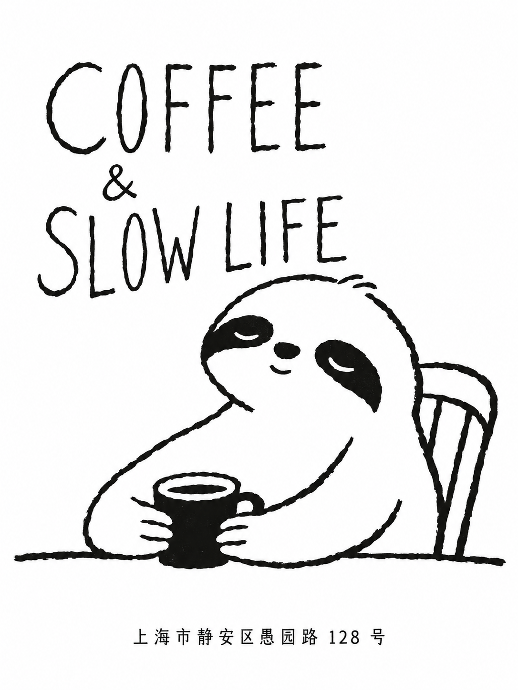

# ink-play-poster

用黑墨线条、原创插画和有性格的手绘字，把一句创意做成一张海报。

适合咖啡店概念、食品单品、社区小店、阅读活动与日常短句。内置九种参考语言，围绕当前主题重新设计角色、动作、字体和构图。

## 演示：咖啡与慢生活

一只树懒靠在椅背上，双手捧着咖啡。窄长的手写大写字沿头部轮廓展开，用松弛的姿态表达「慢生活」。

| 黑白手绘版 | 钴蓝点色版 |
| :---: | :---: |
|  |  |

**首次输入：**

```text
使用 ink-play-poster 生成一个咖啡店概念海报。
主体文案：COFFEE & SLOW LIFE
地点用小字：上海市静安区愚园路 128 号
```

**后续修改：**

```text
允许加上一个跳脱一点的颜色。
```

右图在咖啡杯和「&」上加入钴蓝，延续黑白版的角色、文案和构图。两张图都是本技能的实际生成示例，采用 P05 安静动物店牌方向。

## 可以怎么创作

你可以只提供一句主题，也可以指定原文、风格编号或需要修改的部分：

```text
做一张周末阅读活动海报，标题是「慢慢读」。
给可颂做一张黑白手绘海报，让产品轮廓清楚，字体和卷层曲线呼应。
用 P04 的细长散写方向做一张手冲咖啡海报。
保持这张海报的插画和构图，只重新设计标题字形。
```

以上是请求示例，未展示对应生成结果。没有指定尺寸时，默认使用竖版 3:4、黑白、数字屏幕用途；需要点色时可以直接说明。未提供的日期、价格、品牌和优惠不会自动补入。

## 九种参考语言

同样是黑墨手绘，也可以有不同的轮廓、字形与空间节奏。可以点名编号，也可以让助手根据主题选择。

| 编号 | 方向 | 主要特征 |
| --- | --- | --- |
| P01 | 黑块剪影 | 大轮廓、白色负形、软块展示字 |
| P02 | 轻复古 | 弧排标题、人物动作、少量强调色 |
| P03 | 动作环绕 | 斜向姿态、紧排手写字、周边信息 |
| P04 | 自由散写 | 细长字、错落短行、器物轮廓 |
| P05 | 安静店牌 | 简练动物、桌面场景、疏朗窄长字 |
| P06 | 动态角色 | 重标题、轻轮廓、跨幅动作 |
| P07 | 编辑插画 | 宽窄字对照、信息分组、叙事角色 |
| P08 | 细线单品 | 杯碟结构、弹性展示字、线面反差 |
| P09 | 日常静物 | 环圈连笔、器物穿插、舒展笔势 |

这些是设计参考方向。角色与道具按主题选择：可以有人或动物，也可以只用器物与文字；不会固定套用同一个角色或版式。

## 怎么使用

在 Codex 中调用 `$ink-play-poster`，说明主题和需要上版的文字即可。提供图片时，请说明它是产品外观依据，还是视觉风格参考。

技能会先比较构图方案，再设计图文关系和字形，生成后检查主体结构、文字与画面层级。标题追求字形骨架、比例和书写节奏；地址等事实信息以清楚、准确为先。中文长信息或生成文字有误时，可切换为插画与文字分层制作，最终仍需核对实际成图。

实际出图需要助手环境提供可用的图像生成工具。本仓库的 Python 脚本负责辅助设计、提示词和评估记录，不直接调用图像模型。

## 安装

```bash
git clone https://github.com/guokejie/ink-play-poster.git ~/.codex/skills/ink-play-poster
cd ~/.codex/skills/ink-play-poster
python3 -m pip install -r requirements.txt
```

重新打开 Codex 后调用技能。已有同名目录时，请先检查现有安装。完整创作流程见 [SKILL.md](SKILL.md)。

<details>
<summary>展开查看辅助工具与目录</summary>

```bash
# 查看风格库
python3 scripts/prompt.py --list

# 从完整设计记录生成提示词
python3 scripts/prompt.py brief.json --ready --out prompt.txt

# 检查人工观察记录是否齐全
python3 scripts/review.py qa.json

# 运行工具测试
python3 -m unittest discover -s tests -v
```

`brief.json` 需要包含构图候选、主体识别约束、创意关联、空间和字体方案，具体要求见 [生成流程](references/generation.md)。评估脚本验证观察记录，不能替代看图，也不会自动证明文字正确或设计通过。

```text
.
├── SKILL.md          # 技能入口
├── assets/examples/  # README 实际生成示例
├── assets/posters/   # 九张风格参考
├── assets/details/   # 字体、线条与黑块局部参考
├── references/       # 设计、字体、构图与生成规范
├── scripts/          # 提示词、参考板、合成与评估工具
├── tests/            # 工具测试
├── evals/            # 回归用例与协议
└── agents/           # 助手配置
```

</details>

## 示例与素材说明

README 展示的是本技能生成的咖啡店概念海报，其中的地址是示例输入，不代表真实店铺的经营或品牌声明。生成结果仍需按实际用途审核；普通 RGB 图片不等同于已完成印刷适配的文件。

`assets/posters/` 和 `assets/details/` 中的图片用于视觉研究与风格参考。参考中的原有品牌、签名和文字不应带入新创作，本仓库不另行授予这些参考素材的版权许可。
