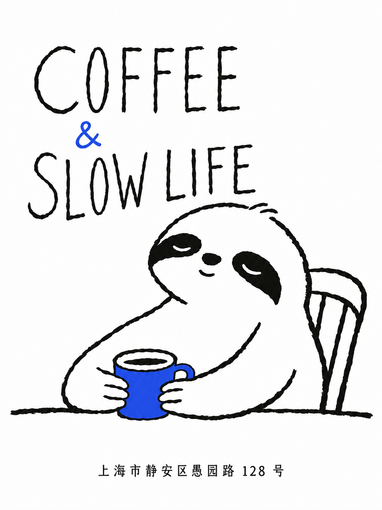
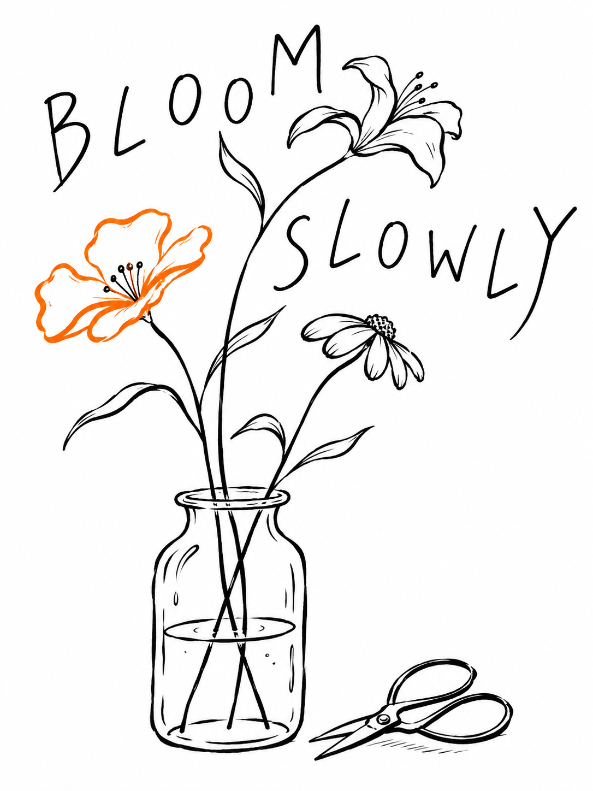

# ink-play-poster

一个用于创作黑墨手绘海报的 Skill。以黑白墨线、原创插画和手绘字体为主要视觉语言，也支持少量点色，适合咖啡店、食品、小店与日常主题的概念海报。

内置九种风格参考，根据主题设计主体、动作、构图与图文关系，支持中文排版、风格融合和局部修改。提供一句创意、需要上版的文案或参考图片，即可开始创作。

## 效果一：咖啡店概念海报

| 提示词 | 生成效果 |
| --- | --- |
| 生成一个咖啡店概念海报。 主体文案：COFFEE & SLOW LIFE 地点用小字：上海市静安区愚园路 128 号 加上一个跳脱一点的颜色。 |  |

## 效果二：花店概念海报

| 提示词 | 生成效果 |
| --- | --- |
| 花店概念海报，白底黑墨手绘，三枝花与玻璃花瓶，旁放花艺剪刀，一朵花用亮橙色。细长手写标题：BLOOM SLOWLY。 |  |
