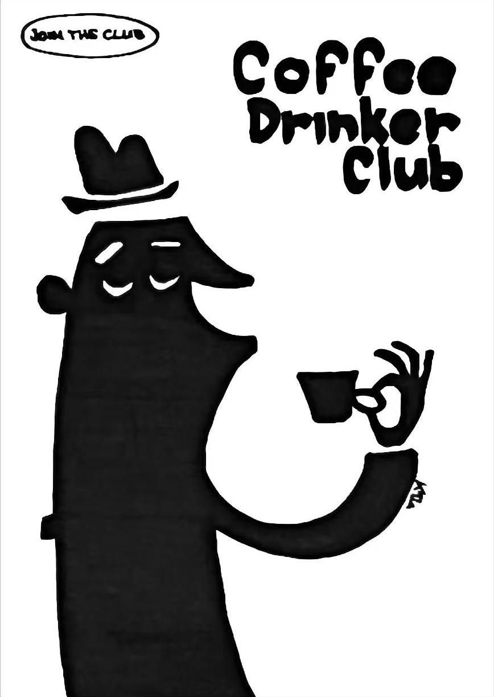
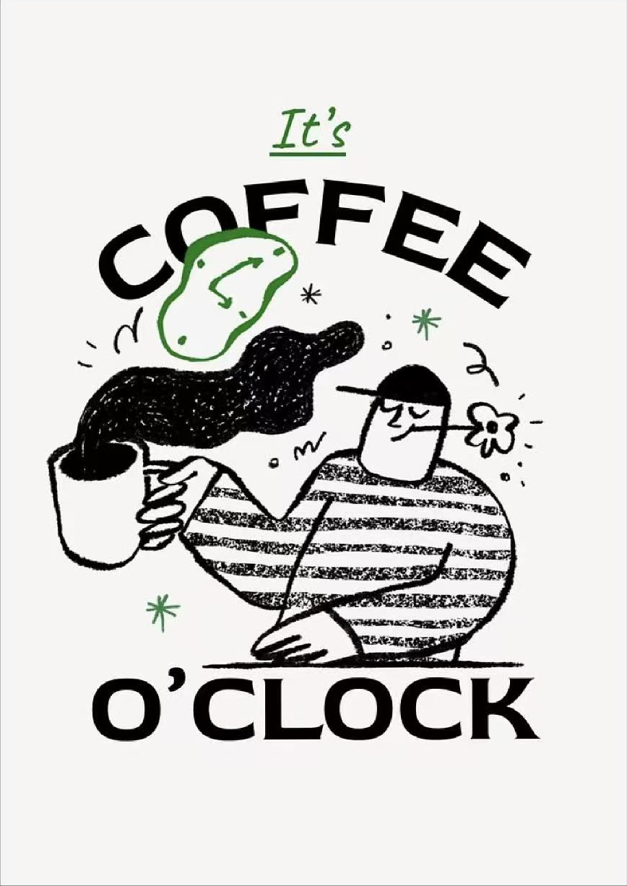
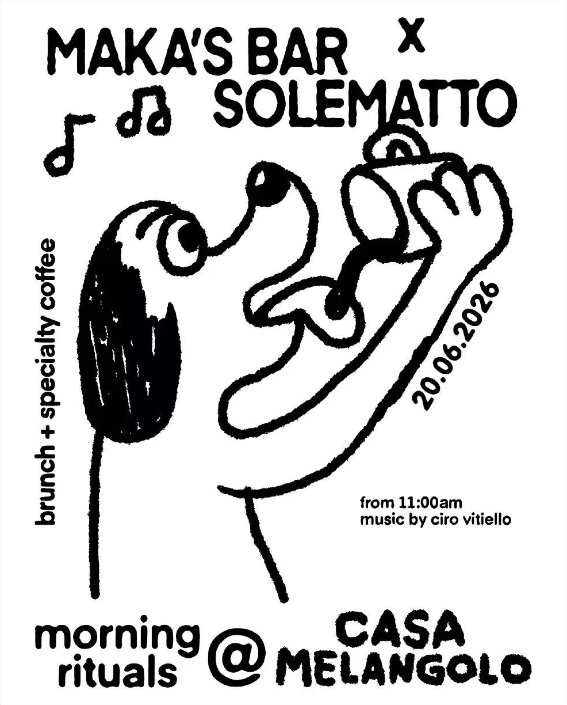
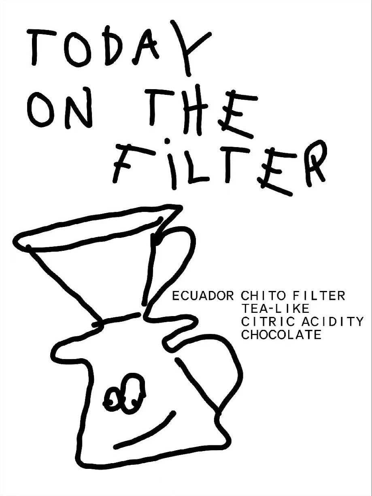
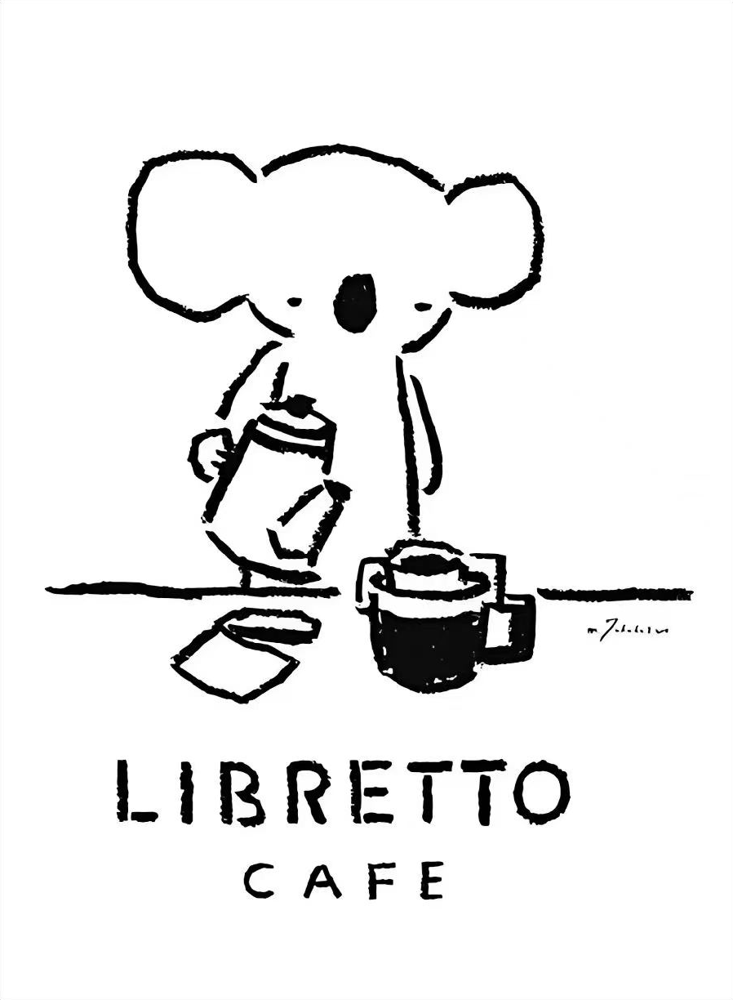
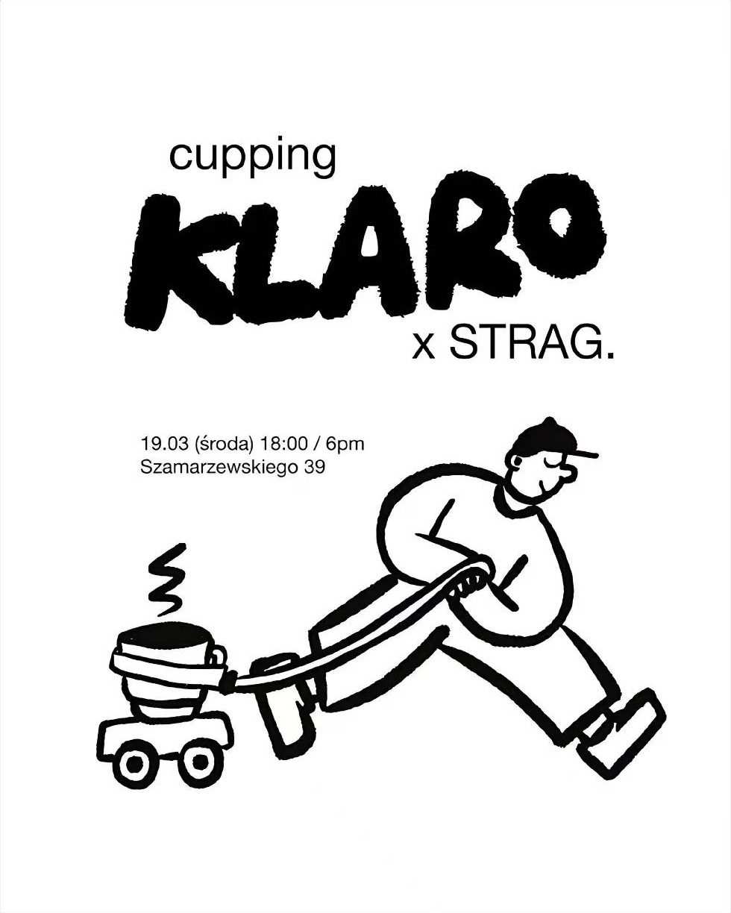
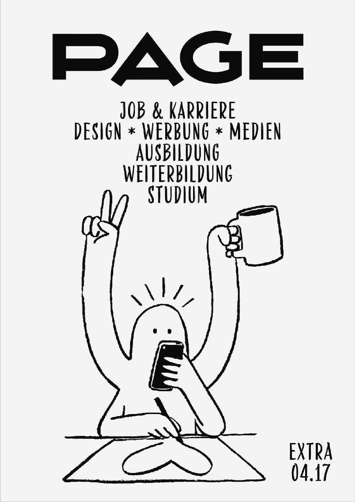
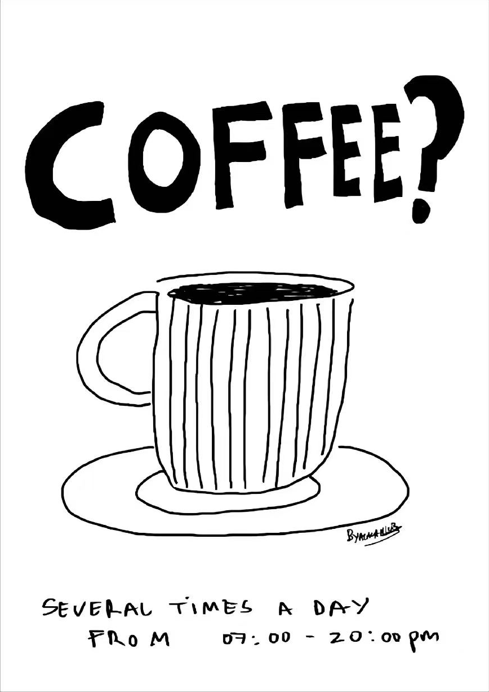
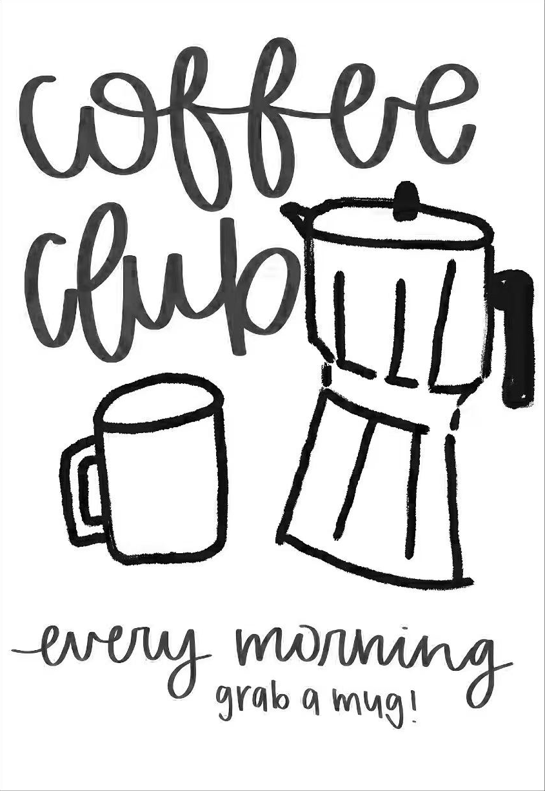

# 九张参考海报的视觉分析

编号按原文件名排序，原图随 Skill 保存，路径见风格库。以下来自逐张视觉观察；不是对作者、字体名称、印刷工艺或艺术史来源的鉴定。所有尺寸比例与色值建议均为创作启发，不是原图精密测量。

## 共性：白纸上的有控制的不规整
九张以独立咖啡文化、日常幽默和手作感为主。可以描述为幼拙手绘、独立刊物式插画与手写招贴的交集；不能简单归为同一种复古字体。黑墨/白纸的高明度对比、有组织的元素分组、夸张比例、清楚的动作或器物关系、图文互相让位，是比“咖啡”更稳定的共同语言。换成书店、花店、展览同样成立。

线条不是随机抖动：外轮廓容易辨认，局部轻微断续、粗细起伏，椭圆不完全对称，人物关节简化。面部通常只用几点几线；实黑块承担结构，空白承担体积。纹理主要在笔画内部，不是铺满背景的脏纸滤镜。没有照片、真实投影、金属高光或三维渲染。

色彩以近白 #FAF9F6 或白、近黑 #111111 为起点，唯P02有绿。色值是建议而非采样结论。默认黑白；绿色风格可试 #39743C，点缀建议控制在画面约5%以内。禁止为了“复古”自动加棕黄底、彩虹渐变。留白不等于每张都居中：P01偏置裁切、P03周边环绕、P07轴线严整、P09文字与物体互嵌。

标题承担图形功能，但精确信息保持规整。建议新画面标题高度占画幅12–25%，主体占幅与边距由参考空间策略决定，不统一设小主体和宽边距；这些是可调整的起点。小字须在最终输出尺寸检查，信息多时减装饰、扩信息区，而不是无限缩小字号。中文标题需要重构字面密度，短标题可圆胖手绘，长中文以可控字体排版。

## 逐张分析

### P01 · 黑块剪影俱乐部

原文件：`微信图片_20261107164346_653_155.png`。

- 美学与情绪：大面积实黑拟人长鼻角色，帽子悬浮；杯子和手势以负形分离，慵懒而幽默。
- 构图与空间：人物左下裁切撑满高度，右上三行胖字，左上椭圆小标；右中留白容纳杯子。
- 色彩与材质：黑白；黑墨略有灰阶，不是立体光照。
- 字体与层级：圆胖不规则手绘标题，字母大小变化而词组紧凑。
- 可迁移方法：将新角色的轮廓变成识别符，保留实黑/负形节奏；更换姿态与物件，别复刻帽子长鼻组合。

### P02 · 绿点复古时间

原文件：`微信图片_20261107164347_654_155.png`。

- 美学与情绪：复古休闲人物、条纹上衣、蒸汽和软形时钟，轻快松弛。
- 构图与空间：上弧形标题、中央半身动作、下方衬线大字构成封闭视觉单元，外围留白。
- 色彩与材质：近白纸底、黑墨、局部草绿；绿色用于时钟、星形和小标题。
- 字体与层级：上弧COFFEE为无衬线大写，底部O’CLOCK为衬线大字，小It’s为斜体；弧形字是构图的一部分。
- 可迁移方法：条纹和墨点提供干印质感；强调色只承担少数焦点，勿将整体变绿。

### P03 · 粗线角色活动

原文件：`微信图片_20261107164348_655_155.png`。

- 美学与情绪：狗形角色仰头举杯，粗糙黑轮廓、黑耳朵与音符，欢快的社区活动感。
- 构图与空间：顶端两行联名，主体形成左下到右上的斜势；左侧竖排、右侧斜日期、底部主办信息围绕角色。
- 色彩与材质：纯黑白，耳朵与字块为黑色重心。
- 字体与层级：粗手写大写配较规整的小号无衬线；信息密但分组明确。
- 可迁移方法：允许信息绕主体走，精确日期和地址用可控排字；勿带入原品牌或原日期。

### P04 · 散排手写器物

原文件：`微信图片_20261107164349_656_155.png`。

- 美学与情绪：滤杯与笑脸壶的幼拙线描，轻松的店内菜单语气。
- 构图与空间：标题分三行错落，器物占左下，右中小信息块利用壶嘴边空白。
- 色彩与材质：白底黑线，几乎不填黑；无渐变。
- 字体与层级：细长手写大写，单字倾斜、字距不等；说明文字规整以补偿标题随性。
- 可迁移方法：器物结构保留功能辨识，错落只作用于标题；不把风味词当通用素材。

### P05 · 安静动物店牌

原文件：`微信图片_20261107164350_657_155.png`。

- 美学与情绪：大耳考拉手冲，点眼黑鼻和局部黑杯，亲切安静。
- 构图与空间：上方有呼吸空间，中央角色及桌线稳定，底部两行店名居中、字距宽。
- 色彩与材质：白底黑墨，黑鼻和黑杯作为两处锚点。
- 字体与层级：稀疏手绘大写，品牌行比副行大，副行宽字距。
- 可迁移方法：少量粗糙断线、极简面部；可以换动物与动作，不复制角色造型及签名。

### P06 · 动态角色联名

原文件：`微信图片_20261107164351_658_155.png`。

- 美学与情绪：圆身人物大步拖着载杯小车，荒诞但一眼读懂动作。
- 构图与空间：上方超重品牌字与小无衬线标题；左中活动信息，下半部横向动势；四边宽留白。
- 色彩与材质：黑白，标题实黑与中空人物平衡。
- 字体与层级：大号粗糙胖字对比简洁无衬线细字。
- 可迁移方法：为新主题构建明确的动作动词；保留标题与插画重量反差，不强制每次都拖车。

### P07 · 编辑封面

原文件：`微信图片_20261107164352_659_155.png`。

- 美学与情绪：几何刊头、窄长字和多臂人物组成编辑插画，机灵忙碌。
- 构图与空间：超大横向刊头→倒三角居中信息→下半人物；右下期号为边注。
- 色彩与材质：近白底黑墨；线条比第3/6张细，刊头更规整。
- 字体与层级：刊头几何粗体，正文窄长手写大写；强烈宽窄对比。
- 可迁移方法：可迁移到阅读、创意与工作主题；多臂是表达多任务的隐喻而非必须元素，不复制PAGE商标。

### P08 · 细线单品问句

原文件：`微信图片_20261107164352_660_155.png`。

- 美学与情绪：单只条纹杯碟，细线歪椭圆、平涂黑咖啡，直接而俏皮。
- 构图与空间：顶部巨型问句，中间孤立器物，下部两行松散小字，三级垂直结构。
- 色彩与材质：白底黑墨；小面积黑填充，大片空白。
- 字体与层级：顶部大小和基线变化的大写，底部低密度手写。
- 可迁移方法：以新单品及短问句构造焦点；细线不可被统一加粗，避免带入原营业时间与签名。

### P09 · 连笔日常静物

原文件：`微信图片_20261107164353_661_155.png`。

- 美学与情绪：马克笔连笔字与粗蜡笔感摩卡壶、马克杯，温暖日常。
- 构图与空间：上方两行连笔标题与右侧大壶穿插，左下小杯平衡，底部两行手写句。
- 色彩与材质：白底黑/深灰；文字可见笔触灰阶，不存在彩色渐变。
- 字体与层级：大环圈连续小写、笔画粗细变化；标题与器物嵌合但需可读。
- 可迁移方法：适合短标题和仪式感主题；中文改用可读的圆润手写字，不能生搬拉丁连笔。

## 核心与变量
核心：黑白或少量强调色、手绘笔触、主体和辅助物的叙事关系、字物重量对话、密区与缓冲区；留白必须有用途。变量：主题、动物/人物/器物、动作、标题所在位置、横竖比例、是否有强调色、信息密度。

不要同时混用全部九张：剪影与细线是不同重心策略，连笔与胖字是不同文字系统。融合时指定一个主导风格，再从第二张借一个维度。用新的角色轮廓、新动作、新标题和新的空间关系构成原创性；不复刻原插画、品牌、签名与版面坐标。

## 字体专项复审
九张标题的骨架、节奏和图文关系逐项复审见 [typography.md](typography.md)。原始色彩、插画与材质分析保持有效；字体不应统一为胖字或固定上下布局。

## 空间专项修订
完整九图复审与每次必做构图方案见 [composition.md](composition.md)，该文取代把本组参考整体概括为极简、大量留白或低图形数量的旧推断。
